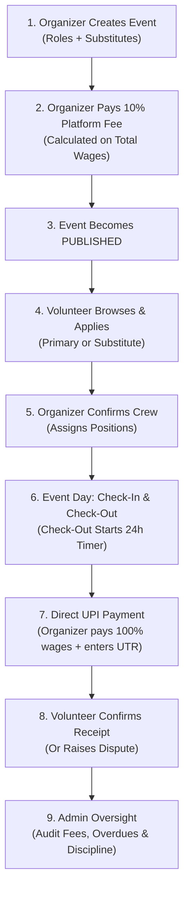

# CrewHub — Comprehensive Quality Assurance & Functionality Testing Guide

> **Version:** 1.0  
> **Platform:** Next.js 14 (App Router) + TypeScript + Prisma + MySQL 8  
> **Author:** CrewHub Core Engineering Team  
> **Target Audience:** QA Engineers, Manual Testers, Product Managers, and Stakeholders

---

## 1. Introduction & Architecture Overview

**CrewHub** is an on-demand event workforce management platform connecting event organizers with qualified temporary staff (crew & volunteers). 

### Key Pillars & Business Rules:
1. **10% Platform Fee**: Organizers pay a mandatory 10% platform fee calculated on the total worker wage budget before publishing an event.
2. **Direct UPI Worker Settlements**: Organizers pay workers directly via UPI (Zero deductions / no platform cuts from wages) and record the transaction UTR number.
3. **Individual 24-Hour Payment Deadline**: Triggered automatically when an organizer marks a worker as **Checked Out** after shift completion.
4. **Reliability & Discipline Policy**:
   - **Volunteers**: 3 shift cancellations trigger a warning alert; 5 shift cancellations trigger **automatic account suspension**.
   - **Organizers**: Overdue worker wages (> 24 hours) automatically restrict event publishing and can lead to account suspension.
5. **Substitute Worker Support**: Every event role includes a backup substitute section. Substitutes are paid only if called in to work.
6. **Event Selector Capsule Bar**: Organizers can filter confirmed crew, financial summaries, and UPI payouts by individual events or across all events.
7. **Mobile & Device Responsiveness**: Universal adaptive styling down to 320px mobile displays.

---

## 2. Test Environment Setup & Quick Start

### 2.1 Prerequisites
- **Node.js**: v18.17.0+ or v20+
- **MySQL**: 8.0+ running on `localhost:3306` with database `crewhub`
- **Web Browser**: Chrome / Safari / Edge / Firefox (Desktop & Mobile Emulation)

### 2.2 Local Server Launch
Run the following commands in the project directory:

```bash
# 1. Install dependencies (if not done already)
npm install

# 2. Run database migrations
npx prisma migrate dev

# 3. Seed fresh test data (Admin, Organizer, Worker, and Demo Events)
npm run db:seed

# 4. Start local development server
npm run dev
```

Open your browser at: **`http://localhost:3000`**

---

## 3. Pre-Seeded Test Credentials Matrix

| Role | Email | Password | Primary Purpose |
| :--- | :--- | :--- | :--- |
| **Volunteer (Worker)** | `volunteer@crewhub.demo` | `Volunteer@123` | Browsing, applying, substitute roles, attendance check-in, tracking UPI wage payouts, raising disputes. |
| **Event Organizer** | `organizer@crewhub.demo` | `Organizer@123` | Creating events, paying 10% platform fee, crew selection, checking out crew, direct UPI payouts, filtering by event. |
| **Super Admin** | `admin@crewhub.demo` | `Admin@123` | Financial audit, monitoring overdue wages, resolving disputes, manual/auto user suspensions. |

> **Note**: You can also register fresh accounts anytime at `http://localhost:3000/register` to test new user flows.

---

## 4. End-to-End Test Scenarios



---

## 5. Test Suite: Role-by-Role Test Cases

### Suite 1: Authentication & Access Control (All Roles)

| Test ID | Test Scenario | Steps to Execute | Expected Result | Pass/Fail |
| :--- | :--- | :--- | :--- | :--- |
| **TC-AUTH-01** | User Registration | 1. Go to `/register`<br/>2. Select role (`Worker` or `Organizer`)<br/>3. Enter valid name, email, password<br/>4. Submit | Account created; user redirected to role-specific dashboard with active session cookie. | [ ] |
| **TC-AUTH-02** | User Login | 1. Go to `/login`<br/>2. Enter valid test credentials<br/>3. Submit | Successful login; redirected to `/worker`, `/organizer`, or `/admin`. | [ ] |
| **TC-AUTH-03** | Invalid Login Handling | 1. Enter wrong password or unregistered email<br/>2. Submit | Clear error message displayed; access rejected without crash. | [ ] |
| **TC-AUTH-04** | Role-Based Access Guards | 1. Log in as `volunteer@crewhub.demo`<br/>2. Manually navigate to `/admin` or `/organizer` | Server middleware/API checks reject access with 403 / redirect to `/worker`. | [ ] |
| **TC-AUTH-05** | Suspended Account Lockout | 1. Have admin suspend an account<br/>2. Attempt to log in with that account | Login blocked with `"This account is suspended. Contact support."` (403 Forbidden). | [ ] |

---

### Suite 2: Volunteer / Worker Workflows (`/worker`)

#### A. Discovery & Application
| Test ID | Test Scenario | Steps to Execute | Expected Result | Pass/Fail |
| :--- | :--- | :--- | :--- | :--- |
| **TC-VOL-01** | Event Browsing & Filters | 1. Go to `/worker?tab=events`<br/>2. Filter by category pills (e.g. `Concert`, `Exhibition`, `Party`)<br/>3. Search by keyword (e.g. "Music")<br/>4. Use city/distance selector | Event list updates in real-time according to selected filters. | [ ] |
| **TC-VOL-02** | View Event Details | 1. Click on an event card (e.g. "Music Concert") | Event Drawer / Details view opens showing date, venue, city, description, shift timings, wage per day, and eligibility. | [ ] |
| **TC-VOL-03** | Primary Role Application | 1. Open event details<br/>2. Select an open job role (e.g. "Crowd management" - ₹450)<br/>3. Click "Apply Now" | Application status becomes `PENDING` or `CONFIRMED`; event appears in "My Shifts". | [ ] |
| **TC-VOL-04** | Substitute Role Application | 1. Apply for a backup substitute role | Clear disclaimer shown: *"Substitutes are standby crew paid only if primary drops out and you work the shift."* Application logged with substitute indicator. | [ ] |

#### B. Shifts & Reliability Discipline (Cancellation Policy)
| Test ID | Test Scenario | Steps to Execute | Expected Result | Pass/Fail |
| :--- | :--- | :--- | :--- | :--- |
| **TC-VOL-05** | View My Shifts | 1. Go to `/worker?tab=applications`<br/>2. Toggle between tabs: `Active`, `Confirmed`, `Past` | User's applied shifts appear with accurate badges (`PENDING`, `CONFIRMED`, `COMPLETED`, `CANCELLED`). | [ ] |
| **TC-VOL-06** | Normal Shift Cancellation (1st & 2nd) | 1. On an active application, click "Cancel Shift"<br/>2. Confirm modal | Shift status changes to `CANCELLED`. Cancellation count increments silently without suspension. | [ ] |
| **TC-VOL-07** | **3rd Cancellation: Warning Notification** | 1. Cancel a 3rd confirmed shift | A high-priority warning notification is delivered to `/worker?tab=notifications`: *"Notice: 3 shift cancellations recorded. 5 cancellations will lead to account suspension."* | [ ] |
| **TC-VOL-08** | **5th Cancellation: Auto-Suspension** | 1. Cancel a 5th confirmed shift | **Discipline policy triggers**: Worker status is immediately set to `SUSPENDED`. Next page load / API call returns 403 Forbidden; user cannot apply for new shifts. | [ ] |

#### C. Payments & Payout Tracking
| Test ID | Test Scenario | Steps to Execute | Expected Result | Pass/Fail |
| :--- | :--- | :--- | :--- | :--- |
| **TC-VOL-09** | Worker Payments Dashboard | 1. Go to `/worker?tab=payments`<br/>2. Check financial summary | Displays total earned, pending settlements, and individual event payout cards. | [ ] |
| **TC-VOL-10** | Verify Payout Status & UTR | 1. Inspect an event where the organizer recorded payment | Card shows status `RECORDED`, amount (100% of wage), timestamp, and the organizer's UTR reference number (e.g. `UPI9921001834`). | [ ] |
| **TC-VOL-11** | Confirm Payment Receipt | 1. Click "Confirm Received" button on a `RECORDED` payment | Status transitions to `CONFIRMED`. Earnings metric updates. | [ ] |
| **TC-VOL-12** | Raise Payment Dispute | 1. On a payment with issues, click "Raise Dispute"<br/>2. Enter dispute description (e.g. "Received ₹350 instead of ₹450")<br/>3. Submit | Status changes to `DISPUTED`. Case is immediately flagged on the Admin Dashboard for investigation. | [ ] |

---

### Suite 3: Event Organizer Workflows (`/organizer`)

#### A. Event Creation & 10% Platform Fee Gate
| Test ID | Test Scenario | Steps to Execute | Expected Result | Pass/Fail |
| :--- | :--- | :--- | :--- | :--- |
| **TC-ORG-01** | "+ New Event" Button Styling | 1. Go to `/organizer?tab=overview`<br/>2. Inspect the "+ New Event" capsule button | Clean pill design (`#111111`), text has **no underline** under any state (normal, hover, active). | [ ] |
| **TC-ORG-02** | Create Event with Substitute Roles | 1. Click "+ New Event" or go to `/organizer?tab=create`<br/>2. Fill Event Title, Category, City, Venue, Dates<br/>3. Add a Job Role (e.g. "Stage Support", 5 vacancies, ₹500/day)<br/>4. Specify backup substitute capacity (e.g. 2 backup spots)<br/>5. Save as Draft | Event saved with status `DRAFT`. Total wage budget is calculated accurately (`5 * 500 = ₹2,500`). | [ ] |
| **TC-ORG-03** | **10% Platform Fee Calculation** | 1. Attempt to publish the draft event | System prompts for 10% Platform Fee: ₹250 (10% of ₹2,500 total worker wage budget). Event cannot be published without fee settlement. | [ ] |
| **TC-ORG-04** | Pay 10% Platform Fee Modal | 1. Click "Pay 10% Platform Fee"<br/>2. Modal displays dynamic QR code & UPI VPA<br/>3. Enter simulated UTR (e.g. `PLATFORM123456`)<br/>4. Confirm | Platform fee status changes to `PAID`. Event status changes from `DRAFT` to `PUBLISHED` and becomes visible to volunteers. | [ ] |

#### B. Crew Management & Attendance
| Test ID | Test Scenario | Steps to Execute | Expected Result | Pass/Fail |
| :--- | :--- | :--- | :--- | :--- |
| **TC-ORG-05** | Review Crew Applicants | 1. Go to `/organizer?tab=crew`<br/>2. Filter by event | Shows list of applied workers with skills, phone, and rating. | [ ] |
| **TC-ORG-06** | Confirm / Accept Volunteers | 1. Click "Accept" / "Confirm" on an applicant | Applicant status changes to `CONFIRMED`. Worker receives confirmation notification. | [ ] |
| **TC-ORG-07** | Substitute Activation | 1. If a primary worker cancels or fails to show up, activate a confirmed substitute | Substitute receives assignment notification; position is transferred. | [ ] |
| **TC-ORG-08** | Mark Check-In | 1. Go to `/organizer?tab=attendance`<br/>2. Select event<br/>3. Click "Check-In" next to a confirmed worker | Worker attendance status changes to `CHECKED_IN` with timestamp. | [ ] |
| **TC-ORG-09** | **Mark Check-Out & 24h Timer Trigger** | 1. On a checked-in worker, click "Check-Out" | Worker status becomes `CHECKED_OUT`. **Crucial**: Starts individual 24-hour payment deadline countdown for this worker. | [ ] |

#### C. Payments, Event Filter Capsule Bar & Direct UPI Settlements
| Test ID | Test Scenario | Steps to Execute | Expected Result | Pass/Fail |
| :--- | :--- | :--- | :--- | :--- |
| **TC-ORG-10** | **Event Selector Capsule Filter Bar** | 1. Go to `/organizer?tab=payments`<br/>2. Observe capsule bar pills: `All Events`, `Music Concert (1/10)`, `Trade Expo (0/10)`, `Comedy Night (0/3)`, `Rooftop Party (0/6)` | Capsule bar displays all events with confirmed crew counts in Joby-style pills. | [ ] |
| **TC-ORG-11** | Filter Workers by Event | 1. Click on "Music Concert"<br/>2. Verify worker table and summary strip | Worker table shows **only** volunteers for Music Concert. Summary strip updates to Music Concert's wage budget, settled, and pending amounts. | [ ] |
| **TC-ORG-12** | Quick Shortcut from Overview | 1. Go to `/organizer?tab=overview`<br/>2. On an event card, click the "Payments" button | Directly opens `/organizer?tab=payments&eventId=<id>` with that event pre-selected in the capsule bar. | [ ] |
| **TC-ORG-13** | Direct 1-Click UPI Payment Modal | 1. On a pending worker row, click "Pay via UPI"<br/>2. Inspect modal | Displays dynamic QR code, Worker Name, UPI ID (`volunteer@oksbi`), and exact wage amount (100% full wage, zero deductions). | [ ] |
| **TC-ORG-14** | Record UTR & Settlement | 1. In payment modal, enter 12-digit UTR (e.g. `UPI8839201948`)<br/>2. Click "Confirm Settlement" | Payment status changes to `RECORDED`. Worker is notified to confirm receipt. Settled counter updates. | [ ] |
| **TC-ORG-15** | 24-Hour Overdue Enforcement | 1. Check an event where check-out occurred > 24 hours ago and payment is still pending | Worker row displays `"OVERDUE"` badge with hours overdue. Organizer receives overdue warning. | [ ] |
| **TC-ORG-16** | Overdue Publishing Lockout | 1. With an active overdue payment, attempt to create/publish a new event | Organizer is blocked with policy warning: *"Publishing restricted due to unsettled overdue worker payments."* | [ ] |
| **TC-ORG-17** | Platform Fees Sub-Tab | 1. Click "Platform Fees (10%)" sub-tab in Payments view | Lists all 10% platform fees per event, base wage budget, fee amount, status (`PAID` / `PENDING`), and UTR receipt. | [ ] |

---

### Suite 4: Super Admin Workflows (`/admin`)

| Test ID | Test Scenario | Steps to Execute | Expected Result | Pass/Fail |
| :--- | :--- | :--- | :--- | :--- |
| **TC-ADM-01** | Platform Fee Monitoring | 1. Go to `/admin`<br/>2. Check Platform Fees Ledger | Displays total platform fee revenue collected, pending fees, and individual event receipts. | [ ] |
| **TC-ADM-02** | Worker Payouts & Overdue Monitor | 1. Navigate to Overdue Settlements section | Lists all overdue payments past 24 hours, organizer contact info, worker UPI ID, and hours overdue. | [ ] |
| **TC-ADM-03** | Dispute Resolution Center | 1. Navigate to Disputes section<br/>2. Select a disputed payment<br/>3. Review worker dispute note & organizer UTR<br/>4. Click "Resolve Dispute" | Admin can mark dispute resolved or override status; logs dispute resolution note. | [ ] |
| **TC-ADM-04** | Volunteer Cancellation Audit | 1. Go to Volunteers tab<br/>2. Inspect cancellation counters | Displays each volunteer's cancellation count. Flags workers with 3+ cancellations (Warning sent) and 5 cancellations (Auto-Suspended). | [ ] |
| **TC-ADM-05** | Manual User Suspension / Reactivation | 1. In Volunteers or Organizers list, find a user<br/>2. Click "Suspend"<br/>3. Enter reason (e.g. "Fraudulent UTR submission")<br/>4. Confirm | User status flips to `SUSPENDED`. Reason is recorded. User is immediately barred from logging in. Click "Reactivate" restores `ACTIVE` status. | [ ] |
| **TC-ADM-06** | Event Moderation | 1. Go to Events tab<br/>2. Filter by status (`PUBLISHED`, `DRAFT`, `SUSPENDED`)<br/>3. Click "Suspend Event" and provide reason | Event is marked `SUSPENDED` and hidden from public search. | [ ] |
| **TC-ADM-07** | Support Tickets | 1. Go to Tickets section<br/>2. Open a submitted inquiry<br/>3. Change status (`RESOLVED`, `CLOSED`) | Ticket status updates and timestamps are saved. | [ ] |

---

### Suite 5: Universal Device Responsiveness & Layout Testing

| Test ID | Viewport / Device | Components to Inspect | Expected Behavior | Pass/Fail |
| :--- | :--- | :--- | :--- | :--- |
| **TC-RES-01** | Mobile (320px - 375px)<br/>*iPhone SE* | - Floating PillNav (`.pill-nav`)<br/>- Event Capsule Bar<br/>- UPI Payment Modal<br/>- Header / Navigation | - No horizontal page overflow (`overflow-x: hidden`).<br/>- PillNav icons fit cleanly (`36px - 42px` width).<br/>- Capsule bar scrolls horizontally with smooth touch scrolling.<br/>- Modals adapt within screen (`calc(100vh - 32px)` max height). | [ ] |
| **TC-RES-02** | Mobile (390px - 430px)<br/>*iPhone 14/15, Pixel* | - Event detail cards<br/>- Attendance check-in buttons<br/>- Stat pills strip | - Elements wrap naturally; touch targets >= 44px.<br/>- Stat pills show 2 per row or stack cleanly. | [ ] |
| **TC-RES-03** | Tablet (768px - 1024px)<br/>*iPad Mini / Air* | - Admin tables<br/>- Organizer Overview grid<br/>- Crew applicant cards | - 2-column card layouts.<br/>- Tables scroll horizontally inside container without breaking page margins. | [ ] |
| **TC-RES-04** | Desktop (1280px - 1920px)<br/>*Full Monitor* | - Full dashboard views<br/>- Multi-column metric cards<br/>- Modal centering | - Centered container (`max-width: 1200px` - `1400px`).<br/>- Crisp typography and proper backdrop blur effects. | [ ] |

---

## 6. Automated Testing & Code Verification

You can run automated test suites anytime from the command line:

```bash
# Run all Vitest unit tests (Discipline, Payments, Location, Validation)
npm test

# Run TypeScript static analysis (Verify 0 compiler errors)
npx tsc --noEmit
```

### Automated Test Coverage Highlights:
- **`tests/payments.test.ts`**:
  - Calculates 10% platform fee on variable worker wage budgets.
  - Verifies 24-hour worker payment deadline window calculation.
  - Enforces organizer publishing restriction when overdue payments exist.
- **`tests/discipline.test.ts`**:
  - Validates warning notification trigger on 3rd volunteer cancellation.
  - Validates automated account suspension on 5th volunteer cancellation.
  - Checks organizer suspension rules for overdue payments.
- **`tests/validation.test.ts`**: Validates form inputs, wages, and date constraints.
- **`tests/location.test.ts`**: Tests geocoding and reverse location calculations.

---

## 7. QA Bug Reporting Template

When logging an issue found during testing, please use this standardized format:

```markdown
### Bug Title: [Brief 1-line description]

- **Role**: [Worker / Organizer / Admin]
- **Page URL**: (e.g. `/organizer?tab=payments`)
- **Device / Viewport**: (e.g. Desktop Chrome 1920x1080 / Mobile iPhone 14 390px)
- **Pre-Conditions**: (e.g. Logged in as `organizer@crewhub.demo`, event has checked-out workers)

#### Steps to Reproduce:
1. Navigate to ...
2. Click on ...
3. Enter ...
4. Click Submit

#### Expected Behavior:
[What should have happened according to specification]

#### Actual Behavior:
[What actually happened, including any console errors or screenshots]

#### Severity:
[ ] Critical (Blocks core flow: payment, publishing, login)
[ ] Major (Feature works partially or incorrect calculation)
[ ] Minor (Styling, alignment, minor UX glitch)
```

---

## 8. Tester Sign-Off Checklist

Before releasing or delivering the build, verify all items:

- [ ] All 3 roles can log in and log out smoothly.
- [ ] 10% Platform fee is calculated accurately and collected prior to event publishing.
- [ ] Substitute worker section displays clear standby payment rules.
- [ ] Worker Check-Out initiates the 24-hour countdown timer.
- [ ] Organizer can filter crew and payouts by clicking pills in the Event Selector Capsule Bar.
- [ ] Direct UPI payout modal generates dynamic QR and pre-fills 100% of the worker's wage.
- [ ] Entering UTR updates payment to `RECORDED`, and worker can confirm or dispute.
- [ ] 3 volunteer cancellations trigger a warning alert; 5 cancellations trigger auto-suspension.
- [ ] Organizers with overdue payments are blocked from publishing new events.
- [ ] Admin can view platform fees, resolve disputes, and manually suspend/reactivate users.
- [ ] Mobile viewports (down to 320px) show no horizontal body overflow.
- [ ] `npm test` passes with 18/18 tests green and `npx tsc --noEmit` exits with 0 errors.